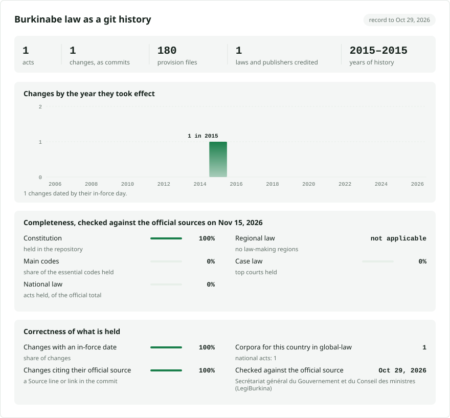

# Burkina Faso: law history in git

[Français](README.md) · **English**

<picture>
<source media="(prefers-color-scheme: dark)" srcset="data/effort-dark.svg">

</picture>

The law of Burkina Faso as a git history: one file per provision, each version committed on the day it took effect, and the law that made each change as the commit's author. `git blame` names the law behind every paragraph; `git log` lists every change to an article; picking a date gives the text in force that day.

Part of [lexifina/global-law](https://github.com/lexifina/global-law), one git history for every country's law: this is Burkina Faso's national law, which global-law reads at `burkina-faso/national/acts/`.

**What is in it now:** the Constitution of 2 June 1991 in two versions (the 2015 consolidation and that of 21 November 2024); the codes (persons and family, penal 1996 then 2018, criminal procedure, civil procedure, labour 2008 then 2026, social security, and others); the laws, ordinances, decrees and arrêtés that the Assemblée législative, LegiBurkina and, failing those, FAOLEX and WIPO Lex publish with a text layer (the count grows as collection goes on); and the 2014 Transition Charter. Folder layout: [STRUCTURE.md](STRUCTURE.md); list of acts: [`corpus.json`](corpus.json).

**Not quite today's text.** The Constitution is current to 21 November 2024; Loi constitutionnelle n°004-2026/ALT of 20 January 2026 is published only as a scan and is not applied. Every other act is in one version, as published (see [What it does not show](#what-it-does-not-show)).

Each provision is one file in `constitution/` (`art-037.md` is Article 37, the President's term of office; `art-160-1.md` is Article 160.1); the preamble is `preambule.md`, and [`constitution/structure.md`](constitution/structure.md) names the article each title and chapter heading precedes.

The text is in French, as LegiBurkina publishes it. An English translation is not part of this record.

## Questions as git commands

| Question | Command |
| --- | --- |
| Every change to Article 37 of the Constitution (the President's term) | `git log -p --word-diff -- constitution/art-037.md` |
| Which law wrote each line of Article 37? | `git blame constitution/art-037.md` |
| Every version of Article 37, with the day each took effect | `git log --format="%h %(trailers:key=In-force,valueonly,separator=) %an" -- constitution/art-037.md` |
| Article 37 as in force on 1 January 2020 | `python tools/en_vigueur_au.py 2020-01-01 constitution 37` |

**Outside git**, we also host this record publicly, for free:

- **[Ask Claude about the law of Burkina Faso](https://global-law.lexifina.com/v1/try_claude?country=burkina-faso)**: opens Claude with a first question ready.
- **[Ask ChatGPT](https://global-law.lexifina.com/v1/try_chatgpt?country=burkina-faso)**: the same question in ChatGPT.
- **[Search the law of Burkina Faso on our site](https://lexifina.com/law?country=burkina-faso&q=droit+de+gr%C3%A8ve)**: a search for "droit de grève" (the right to strike), with each provision's text and its versions, no account needed.
- **[Developer REST API](https://global-law.lexifina.com/v1/search_law?query=droit+de+gr%C3%A8ve&jurisdiction=burkina-faso)**: the same search as JSON, with no key. See the [documentation here](https://lexifina.com/api/global-law).

Both assistants read the record through the free Global law connector (MCP, `https://global-law.lexifina.com/mcp`); the first time, the chat gives you the link that adds it. Ask in French or in English.

**Host it yourself easily.** All it takes is git and Python, and the tools run on your machine:

```sh
git clone --depth 1 https://github.com/lexifina/global-law && cd global-law
python3 tools/countries.py add burkina-faso/national/acts
python3 tools/law.py show 2026-01-01 burkina-faso/national/acts/constitution/art-037.md
```

Opened in Claude Code, Cursor, VS Code or Codex, the clone also starts a local MCP server with the same tools ([MCP.md](https://github.com/lexifina/global-law/blob/main/MCP.md)).

## Dates

Each commit is dated at noon, Africa/Ouagadougou (UTC), on the day the version took effect, and carries it in its `In-force:` trailer:

- the Constitution's 2024 version is dated 21 November 2024, the day of Décret n°2024-1430/PRES promulgating Loi constitutionnelle n°033-2024/ALT (cover page; it also contains Loi n°045-2023/ALT, promulgated 22 January 2024, which has no consolidation of its own);
- laws are dated by their promulgation when the Assemblée législative's list or the text itself gives it, otherwise by their adoption; decrees and arrêtés by their signature; compiled codes by the latest promulgation the compilation names. The `In-force-basis` trailer says which each time; these sources do not give the Journal officiel date;
- the Constitution's first version is dated 26 November 2015, the day of Décret n°2015-1396/PRES-TRANS, which promulgated Loi constitutionnelle n°072-2015/CNT, as the consolidation's cover prints it; the day of its publication in the Journal officiel was not found.

The consolidation is not the Constitution as adopted, so its commit is credited to the publisher, the Secrétariat général du Gouvernement et du Conseil des ministres (which runs LegiBurkina), as the oldest version available, and names the 1991 Constitution and the eight revision laws the cover lists. The committer is always Lexifina.

## How it is checked

- `tools/check_repo.py` reads every version back from git on the day it took effect and on the day before, and both must match the corpus the history was built from; it also checks that every commit's trailers parse, that there are no merge commits and that no commit is dated in the future.
- `tools/build.py` writes the history from that corpus in one pass; a second build into an empty folder gave identical hashes. The results are in [`REPRODUCE.md`](REPRODUCE.md), and [`data/corpus.sha256`](data/corpus.sha256) gives the corpus's hash.
- The text is the PDF's own text layer (the file was made with Word, not scanned). Only line breaks, footnotes, the cover page and typesetting were changed, as [`LICENSE`](LICENSE) lists; the wording was not.
- Laws, decrees, codes and charters added on 26 November 2026: only the PDF's text layer is used (no OCR of ours); each text must name its own number on its first pages or it is held; duplicates across sources are dropped in favour of the official source.
- [vulnerabilities/](vulnerabilities/README.en.md): possible drafting mistakes in this law, found by global-law's detectors and checked by hand. Not run yet.

## What it does not show

- **The 2026 constitutional revision** (Loi n°004-2026/ALT of 20 January 2026): published only as a scan, not transcribed. The 2022 and 2024 Transition Charters and the MPSR Fundamental Act are the same.
- **Texts published only as scans:** most LegiBurkina PDFs are scans without a text layer; they are not transcribed (no OCR). The Journal officiel (jobf.gov.bf) is a subscription service and is not used.
- **Successive amendments to laws:** each law, decree or arrêté is in one version, as published; only the codes and the Constitution have several versions.
- **The Constitution before 2015**, and the words each of the eight revisions since 1991 replaced: LegiBurkina publishes only the 2015 consolidation as text, and its footnotes, which say how each revision changed each provision, are left out.
- **Headings** (titres, chapitres) are not in the article files; `structure.md` gathers them.
- **The Code civil of 1804** as applied in Burkina Faso and the Code des impôts: compilations with no version date, held.

## Sources

| Source | Kind | Past versions | Notes |
| --- | --- | --- | --- |
| [LegiBurkina](https://www.legiburkina.gov.bf/textesFondamentaux) (Secrétariat général du Gouvernement et du Conseil des ministres) | Official portal of Burkina Faso law: fundamental texts, laws and decrees as PDFs | no, the 2015 consolidation only | The Constitution's text, and its date from the consolidation's cover |
| [Assemblée nationale / Assemblée législative de transition](https://www.assembleenationale.bf/loip) | List of adopted laws (2018-2026), with adoption and promulgation dates and PDFs of most | as adopted | Laws (text layer) |
| [Direction générale des réformes de l’État](https://dgre.gov.bf/) | Constitution consolidated after Loi n°033-2024/ALT | the 2024 consolidation | The Constitution's 2024 version |
| Ministry of Justice (justice.gov.bf, "Codes et Lois") and the former LegiBurkina (legiburkina.bf), through the Internet Archive | Compiled codes as PDFs; the sites are gone, archived copies | one compilation per code | Codes (secondary copy) |
| [FAOLEX](https://www.fao.org/faolex/) (FAO) and [WIPO Lex](https://www.wipo.int/wipolex/) (WIPO) | Official texts as PDFs | one version | Laws, decrees and arrêtés missing from the official sources as text (secondary copy) |

## Licence

See [`LICENSE`](LICENSE). The texts are official texts of Burkina Faso, reproduced with their source named (in each folder and each commit); none of the sources states a licence for legal texts. The history, commit messages, tables and tools are CC0 1.0.

No AI model wrote, translated or corrected legal text, and none runs when the history is built; the scripts were written by an AI model (see [`REPRODUCE.md`](REPRODUCE.md)).

## Visualisations

- [visualisations/](visualisations/README.en.md): charts drawn from this repository. Not drawn yet.

## More

From [lexifina/global-law](https://github.com/lexifina/global-law):

- [FEATURES.md](https://github.com/lexifina/global-law/blob/main/FEATURES.md): every feature, and what every corpus must support (`git blame`, `law.py`, the MCP tools)
- [FAQ.md](https://github.com/lexifina/global-law/blob/main/FAQ.md): questions and answers · [CONTRIBUTING.md](https://github.com/lexifina/global-law/blob/main/CONTRIBUTING.md): proposing changes · [MCP.md](https://github.com/lexifina/global-law/blob/main/MCP.md): the MCP server · [REPRODUCE.md](https://github.com/lexifina/global-law/blob/main/REPRODUCE.md): how it was built · [CHANGELOG.md](https://github.com/lexifina/global-law/blob/main/CHANGELOG.md)
- [FRESHNESS.md](https://github.com/lexifina/global-law/blob/main/FRESHNESS.md): how current each corpus is · [Monitoring](https://github.com/lexifina/global-law/tree/main/monitoring): whether updates are running · [WATCHING.md](https://github.com/lexifina/global-law/blob/main/WATCHING.md): how each official source is watched for changes
- [performance/](https://github.com/lexifina/global-law/tree/main/performance): how fast the tools are, measured
- [visualisations/](https://github.com/lexifina/global-law/tree/main/visualisations): charts and bridges across the world's law
- [Vulnerabilities](https://github.com/lexifina/global-law/tree/main/vulnerabilities): mistakes in legislation as published
