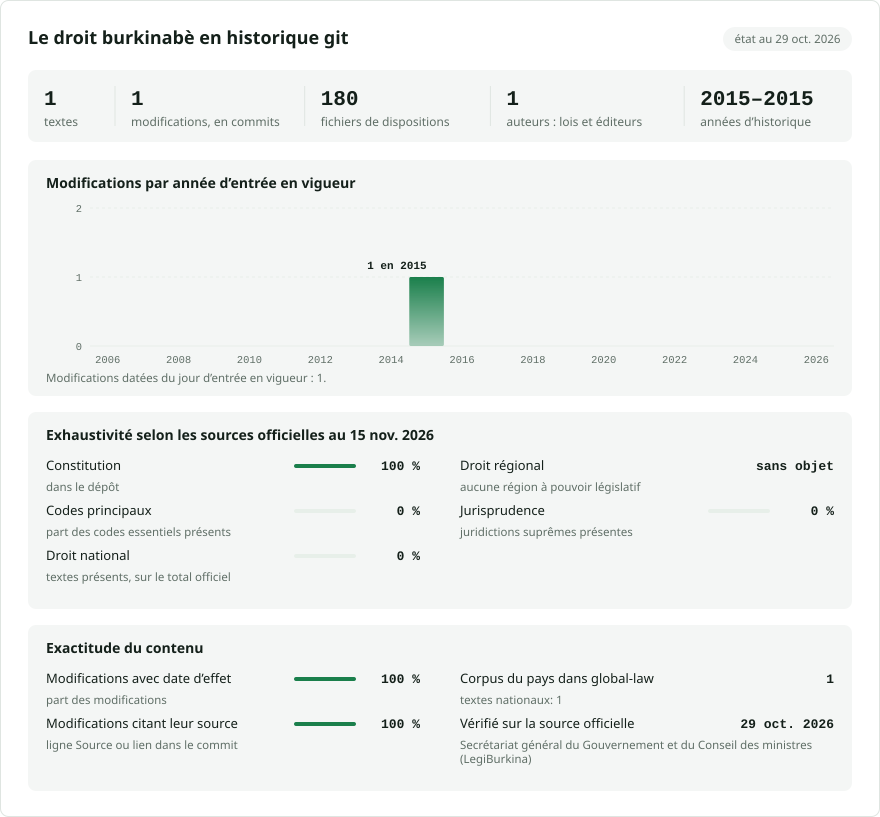

# Burkina Faso : l’historique du droit dans git

**Français** · [English](README.en.md)

<picture>
<source media="(prefers-color-scheme: dark)" srcset="data/fr/effort-dark.svg">

</picture>

Le droit burkinabè sous forme d’historique git : un fichier par disposition, chaque version enregistrée au jour de son entrée en vigueur, et pour auteur de chaque commit la loi qui a apporté la modification. `git blame` désigne la loi à l’origine de chaque alinéa ; `git log` énumère toutes les modifications d’un article ; le choix d’une date donne le texte en vigueur ce jour-là.

Fait partie de [lexifina/global-law](https://github.com/lexifina/global-law), un historique git unique pour le droit de chaque pays : ce dépôt contient le droit national du Burkina Faso, que global-law lit dans `burkina-faso/national/acts/`.

**Contenu actuel :** la Constitution du 2 juin 1991 en deux versions (consolidations de 2015 et du 21 novembre 2024) ; les codes (personnes et famille, pénal 1996 puis 2018, procédure pénale, procédure civile, travail 2008 puis 2026, sécurité sociale, et d’autres) ; les lois, ordonnances, décrets et arrêtés publiés avec une couche texte par l’Assemblée législative, LegiBurkina et, à défaut, FAOLEX et WIPO Lex (le nombre augmente à mesure que la collecte avance) ; et la Charte de la Transition de 2014. Disposition des dossiers : [STRUCTURE.md](STRUCTURE.md) ; liste des textes : [`corpus.json`](corpus.json).

**Pas tout à fait le texte en vigueur aujourd’hui.** La Constitution est à jour au 21 novembre 2024 ; la loi constitutionnelle n°004-2026/ALT du 20 janvier 2026 n’est publiée que sous forme de numérisation et n’est pas appliquée. Les autres textes sont chacun en une version, telle que publiée (voir [Ce qu’il ne montre pas](#ce-quil-ne-montre-pas)).

Chaque disposition est un fichier dans `constitution/` (`art-037.md` est l’article 37, relatif à la durée du mandat du Président du Faso ; `art-160-1.md` est l’article 160.1) ; le préambule est `preambule.md`, et [`constitution/structure.md`](constitution/structure.md) indique l’article que précède chaque intitulé de titre et de chapitre.

Le texte est en français, tel que le publie LegiBurkina. Une traduction anglaise ne fait pas partie de ce registre.

## Questions sous forme de commandes git

| Question | Commande |
| --- | --- |
| Toutes les modifications de l’article 37 de la Constitution (le mandat du Président) | `git log -p --word-diff -- constitution/art-037.md` |
| Quelle loi a écrit chaque ligne de l’article 37 ? | `git blame constitution/art-037.md` |
| Toutes les versions de l’article 37, avec le jour d’entrée en vigueur de chacune | `git log --format="%h %(trailers:key=In-force,valueonly,separator=) %an" -- constitution/art-037.md` |
| L’article 37 tel qu’en vigueur le 1er janvier 2020 | `python tools/en_vigueur_au.py 2020-01-01 constitution 37` |

**En dehors de git**, nous hébergeons aussi ce registre publiquement, gratuitement :

- **[Interroger Claude sur le droit du Burkina Faso](https://global-law.lexifina.com/v1/try_claude?country=burkina-faso)** : ouvre Claude avec une première question prête.
- **[Interroger ChatGPT](https://global-law.lexifina.com/v1/try_chatgpt?country=burkina-faso)** : la même question dans ChatGPT.
- **[Rechercher dans le droit du Burkina Faso sur notre site](https://lexifina.com/law?country=burkina-faso&q=droit+de+gr%C3%A8ve)** : une recherche de « droit de grève », avec le texte de chaque disposition et ses versions, sans compte.
- **[API REST pour les développeurs](https://global-law.lexifina.com/v1/search_law?query=droit+de+gr%C3%A8ve&jurisdiction=burkina-faso)** : la même recherche en JSON, sans clé. Voir la [documentation ici](https://lexifina.com/api/global-law).

Les deux assistants lisent le registre au moyen du connecteur gratuit Global law (MCP, `https://global-law.lexifina.com/mcp`) ; la première fois, la conversation vous donne le lien qui l’ajoute. Posez vos questions en français ou en anglais.

**L’héberger vous-même, simplement.** Il suffit de git et de Python, et les outils s’exécutent sur votre machine :

```sh
git clone --depth 1 https://github.com/lexifina/global-law && cd global-law
python3 tools/countries.py add burkina-faso/national/acts
python3 tools/law.py show 2026-01-01 burkina-faso/national/acts/constitution/art-037.md
```

Ouvert dans Claude Code, Cursor, VS Code ou Codex, le clone lance aussi un serveur MCP local doté des mêmes outils ([MCP.md](https://github.com/lexifina/global-law/blob/main/MCP.md)).

## Dates

Chaque commit est daté à midi, heure de Ouagadougou (Africa/Ouagadougou, UTC), du jour où la version est entrée en vigueur, et porte ce jour dans son trailer `In-force:` :

- la version de 2024 de la Constitution est datée du 21 novembre 2024, jour du décret n°2024-1430/PRES portant promulgation de la loi constitutionnelle n°033-2024/ALT (page de couverture ; elle contient aussi la loi n°045-2023/ALT, promulguée le 22 janvier 2024, qui n’a pas de consolidation propre) ;
- les lois sont datées du jour de leur promulgation lorsque le répertoire de l’Assemblée législative ou le texte lui-même le donne, sinon du jour de leur adoption ; les décrets et arrêtés, du jour de leur signature ; les codes compilés, de la dernière promulgation que la compilation mentionne. Le trailer `In-force-basis` dit chaque fois laquelle ; la date du Journal officiel n’est pas donnée par ces sources ;
- la première version de la Constitution est datée du 26 novembre 2015, jour du décret n°2015-1396/PRES-TRANS portant promulgation de la loi constitutionnelle n°072-2015/CNT, tel que l’indique la page de couverture de la version consolidée ; la date de sa publication au Journal officiel n’a pas été trouvée.

La version consolidée n’est pas la Constitution telle qu’adoptée ; son commit est donc attribué à l’éditeur, le Secrétariat général du Gouvernement et du Conseil des ministres (qui gère LegiBurkina), en tant que plus ancienne version disponible, et nomme la Constitution de 1991 ainsi que les huit lois de révision qu’énumère la page de couverture. Le committer est toujours Lexifina.

## Comment il est vérifié

- `tools/check_repo.py` relit chaque version depuis git au jour de son entrée en vigueur et la veille, et les deux doivent correspondre au corpus à partir duquel l’historique a été construit ; il vérifie aussi que les trailers de chaque commit se lisent sans erreur, qu’il n’existe aucun commit de fusion et qu’aucun commit n’est daté dans le futur.
- `tools/build.py` écrit l’historique à partir de ce corpus en une seule passe ; une seconde construction dans un dossier vide a donné des empreintes identiques. Les résultats figurent dans [`REPRODUCE.md`](REPRODUCE.md), et [`data/corpus.sha256`](data/corpus.sha256) donne l’empreinte du corpus.
- Le texte est la couche texte propre au PDF (le fichier a été produit avec Word, et non numérisé). Seuls les sauts de ligne, les notes de bas de page, la page de couverture et la composition typographique ont été modifiés, comme l’énumère [`LICENSE`](LICENSE) ; la rédaction ne l’a pas été.
- Lois, décrets, codes et chartes ajoutés le 26 novembre 2026 : seule la couche texte du PDF est reprise (aucune OCR de notre part) ; chaque texte doit citer son propre numéro dans ses premières pages, sinon il est écarté ; les doublons entre sources sont écartés au profit de la source officielle.
- [vulnerabilities/](vulnerabilities/): erreurs de rédaction possibles dans ce droit, trouvées par les détecteurs de global-law et vérifiées à la main. Pas encore lancé.

## Ce qu’il ne montre pas

- **La révision constitutionnelle de 2026** (loi n°004-2026/ALT du 20 janvier 2026) : publiée seulement sous forme de numérisation, non transcrite. Les Chartes de la Transition de 2022 et 2024 et l’Acte fondamental du MPSR sont dans le même cas.
- **Les textes publiés seulement en numérisation** : la plupart des PDF de LegiBurkina sont des scans sans couche texte ; ils ne sont pas transcrits (pas d’OCR). Le Journal officiel (jobf.gov.bf) est un service sur abonnement et n’est pas repris.
- **Les modifications successives des lois** : chaque loi, décret ou arrêté est en une version, telle que publiée ; seuls les codes et la Constitution ont plusieurs versions.
- **La Constitution avant 2015**, ni les termes que chacune des huit révisions intervenues depuis 1991 a remplacés : LegiBurkina ne publie sous forme de texte que la version consolidée de 2015, et ses notes de bas de page, qui indiquent comment chaque révision a modifié chaque disposition, sont omises.
- **Les intitulés** (titres, chapitres) ne figurent pas dans les fichiers des articles ; `structure.md` les regroupe.
- **Le Code civil de 1804** tel qu’applicable au Burkina Faso et le Code des impôts : compilations sans date de version, écartées.

## Sources

| Source | Nature | Versions antérieures | Remarques |
| --- | --- | --- | --- |
| [LegiBurkina](https://www.legiburkina.gov.bf/textesFondamentaux) (Secrétariat général du Gouvernement et du Conseil des ministres) | Portail officiel du droit burkinabè : textes fondamentaux, lois et décrets en PDF | non, la seule version consolidée de 2015 | Le texte de la Constitution, et sa date tirée de la page de couverture de la version consolidée |
| [Assemblée nationale / Assemblée législative de transition](https://www.assembleenationale.bf/loip) | Répertoire des lois adoptées (2018-2026), avec dates d’adoption et de promulgation et le PDF de la plupart | telles qu’adoptées | Lois (couche texte) |
| [Direction générale des réformes de l’État](https://dgre.gov.bf/) | Constitution consolidée après la loi n°033-2024/ALT | consolidation de 2024 | Version 2024 de la Constitution |
| Ministère de la Justice (justice.gov.bf, « Codes et Lois ») et ancien LegiBurkina (legiburkina.bf), via l’Internet Archive | Codes compilés en PDF ; sites disparus, copies archivées | une compilation par code | Codes (copie secondaire) |
| [FAOLEX](https://www.fao.org/faolex/) (FAO) et [WIPO Lex](https://www.wipo.int/wipolex/) (OMPI) | Textes officiels en PDF | une version | Lois, décrets et arrêtés absents des sources officielles en texte (copie secondaire) |

## Licence

Voir [`LICENSE`](LICENSE). Les textes sont des textes officiels du Burkina Faso, reproduits avec la mention de leur source (chaque dossier et chaque commit la donnent) ; aucune des sources n’indique de licence pour les textes juridiques. L’historique, les messages de commit, les tableaux et les outils sont sous CC0 1.0.

Aucun modèle d’IA n’a écrit, traduit ou corrigé de texte juridique, et aucun n’est exécuté lors de la construction de l’historique ; les scripts ont été écrits par un modèle d’IA (voir [`REPRODUCE.md`](REPRODUCE.md)).

Ceci est une traduction de la version anglaise ([README.en.md](README.en.md)) ; en cas de divergence, la version anglaise fait foi.

## Visualisations

- [visualisations/](visualisations/): graphiques tirés de ce dépôt. Pas encore dessinés.

## En savoir plus

Dans le dépôt [lexifina/global-law](https://github.com/lexifina/global-law) (pages en anglais) :

- [FEATURES.md](https://github.com/lexifina/global-law/blob/main/FEATURES.md): toutes les fonctionnalités et ce que chaque corpus doit prendre en charge (`git blame`, `law.py`, outils MCP)
- [FAQ.md](https://github.com/lexifina/global-law/blob/main/FAQ.md): questions et réponses · [CONTRIBUTING.md](https://github.com/lexifina/global-law/blob/main/CONTRIBUTING.md): proposer une modification · [MCP.md](https://github.com/lexifina/global-law/blob/main/MCP.md): serveur MCP · [REPRODUCE.md](https://github.com/lexifina/global-law/blob/main/REPRODUCE.md): comment il a été construit · [CHANGELOG.md](https://github.com/lexifina/global-law/blob/main/CHANGELOG.md)
- [FRESHNESS.md](https://github.com/lexifina/global-law/blob/main/FRESHNESS.md): à quel point chaque corpus est à jour · [Surveillance](https://github.com/lexifina/global-law/tree/main/monitoring): si les mises à jour fonctionnent · [WATCHING.md](https://github.com/lexifina/global-law/blob/main/WATCHING.md): comment chaque source officielle est surveillée pour repérer les modifications
- [performance/](https://github.com/lexifina/global-law/tree/main/performance): la rapidité des outils, mesurée
- [visualisations/](https://github.com/lexifina/global-law/tree/main/visualisations): graphiques et liens à travers le droit du monde entier
- [Vulnérabilités](https://github.com/lexifina/global-law/tree/main/vulnerabilities): erreurs dans les textes tels qu’ils ont été publiés
